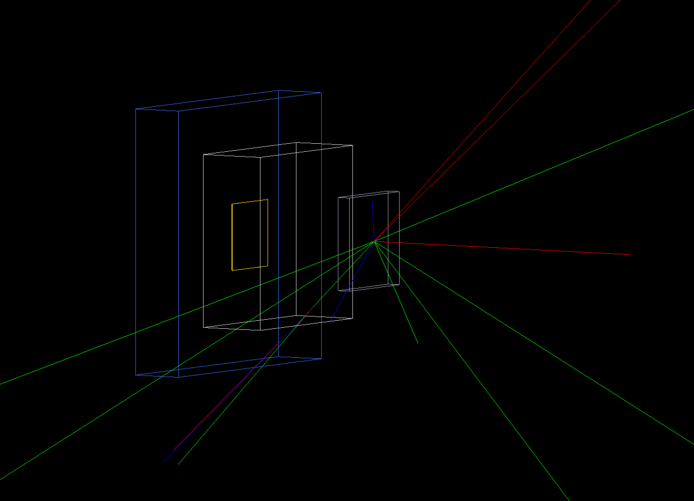
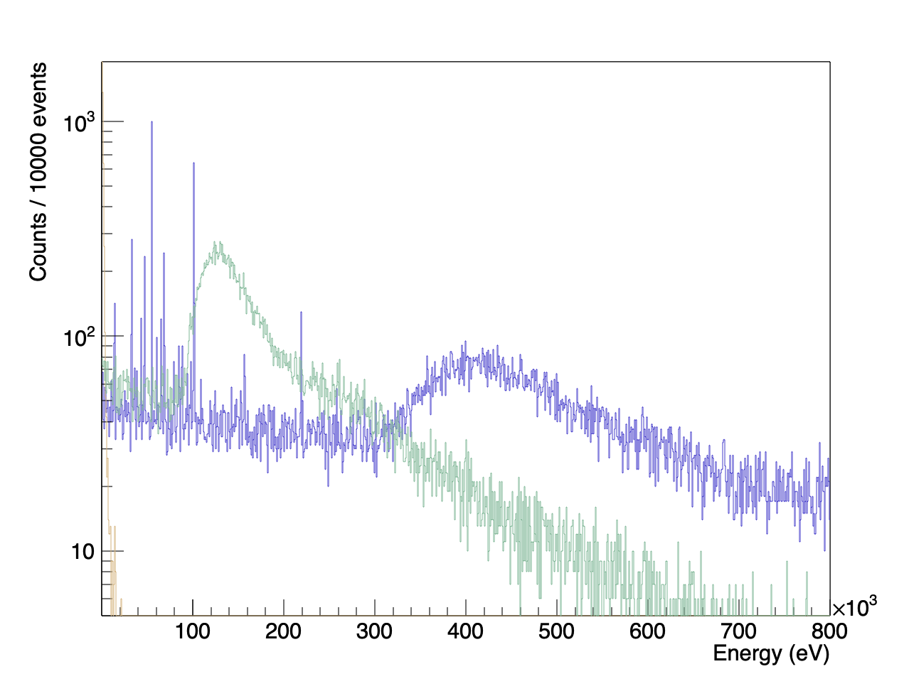

PAX1 Pixel Simulation
---

Quick and dirty G4 app.
Target of this is to get a PAX1 style TES pixel in front of a beam.
My Specific interest at the moment is to have antiproton annihilation products so I take a pbar beam and send it onto a target. 

I bootstrapped this with claude giving some rough prompt where I asked for a model like Example B4d then refined afterwards by hand.

After handing it a reasonable estimate of the pixel geometry

I get a reasonable background spectrum:

